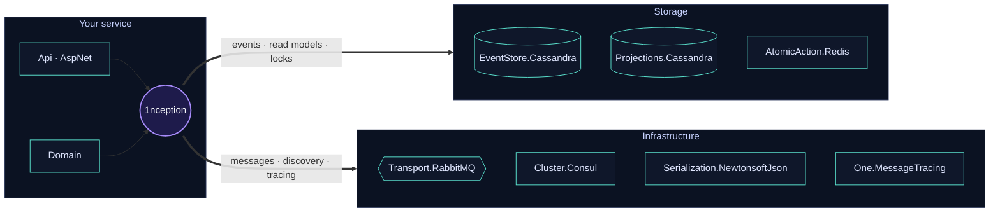

<p align="center">
  
</p>

<p align="center">
  <a href="https://www.nuget.org/packages/1nception"></a>
  <a href="https://www.nuget.org/packages/1nception"></a>
  <a href="https://www.nuget.org/packages/1nception.Projections.Cassandra"></a>
  <a href="https://www.nuget.org/packages/1nception.EventStore.Cassandra"></a>
</p>

<p align="center">
  
  
  
  
  
</p>

---

## 🌀 1nception: event sourcing for .NET, with the hard parts already done

Most event-sourcing libraries stop at *"store the events"*. 1nception also takes care of everything that comes after:
rebuilding read models when the code changes, reading the past, replaying history, isolating tenants, and keeping it all running in production.

<p align="center">
  
</p>

---

## ✨ Projections that rebuild themselves

<p align="center">
  
</p>

A projection is identified by the events it handles. Add or remove an `IEventHandle<T>` and its hash changes, so 1nception
**starts a new version**, replays the event store into it and **switches reads over once it has caught up**. No migration scripts, no downtime, no "please wait while we rebuild".

- The rebuild runs as a cluster job with **progress signals**, a **timebox**, and can be **paused, cancelled or finalized** through the API.
- Projections are event-sourced with **snapshots**, so loading stays fast however long the history gets.
- Need to **fix** a broken read model? Trigger a rebuild of the same version through the API.

---

## ⏪ Time-travel queries

<p align="center">
  
</p>

Because projections are built from events, the past is never lost. Ask for any projection **as it was at any moment**:
audits, support tickets ("what did the customer see on Tuesday?"), reports for a past period, debugging a production issue.

---

## 🧩 Built for production

<p align="center">
  
</p>

---

## 🏗️ Architecture

Pick the core, then plug in the storage, transport and clustering you need.



<details>
<summary><b>📦 All 1nception packages</b></summary>
<br>

| Layer | Packages |
|---|---|
| **Core** | [`1nception`](https://github.com/1SoftwareCompany/1nception) · [`Domain`](https://github.com/1SoftwareCompany/1nception.Domain) · [`Api`](https://github.com/1SoftwareCompany/1nception.Api) · [`AspNet`](https://github.com/1SoftwareCompany/1nception.AspNet) |
| **Persistence** | [`EventStore.Cassandra`](https://github.com/1SoftwareCompany/1nception.EventStore.Cassandra) · [`Projections.Cassandra`](https://github.com/1SoftwareCompany/1nception.Projections.Cassandra) · [`AtomicAction.Redis`](https://github.com/1SoftwareCompany/1nception.AtomicAction.Redis) |
| **Infrastructure** | [`Transport.RabbitMQ`](https://github.com/1SoftwareCompany/1nception.Transport.RabbitMQ) · [`Cluster.Consul`](https://github.com/1SoftwareCompany/1nception.Cluster.Consul) · [`Serialization.NewtonsoftJson`](https://github.com/1SoftwareCompany/1nception.Serialization.NewtonsoftJson) |
| **Tooling** | [`SourceGeneration.AutoUpdater`](https://github.com/1SoftwareCompany/1nception.SourceGeneration.AutoUpdater) |

</details>

```bash
dotnet add package 1nception
```

📖 **[Read the docs](https://github.com/1SoftwareCompany/1nception/tree/master/docs)** · 🚀 **[Quick start](https://github.com/1SoftwareCompany/1nception/tree/master/docs/getting-started/quick-start)**

---

## 🔎 Around the framework

<p align="center">
  
</p>

<table>
<tr>
<td width="50%" valign="top">

**[One.MessageTracing](https://github.com/1SoftwareCompany/One.MessageTracing)**<br>
Records the message, correlation and causation ID of every action, so you can follow any chain of events from start to finish.

</td>
<td width="50%" valign="top">

**[Sett1x](https://github.com/1SoftwareCompany/Sett1x)**<br>
Externalized configuration per cluster and machine, kept outside your repo.
Extensions: [Consul](https://github.com/1SoftwareCompany/Sett1x.Consul) · [RabbitMQ](https://github.com/1SoftwareCompany/Sett1x.RabbitMQ) · [CLI](https://github.com/1SoftwareCompany/Sett1x.Cli)

</td>
</tr>
</table>

---

<p align="center">
  <sub>Found a bug or have an idea? Open an issue in the relevant repository. Contributions are welcome, and ⭐ stars help others find 1nception.</sub>
</p>

<p align="center">
  
</p>
